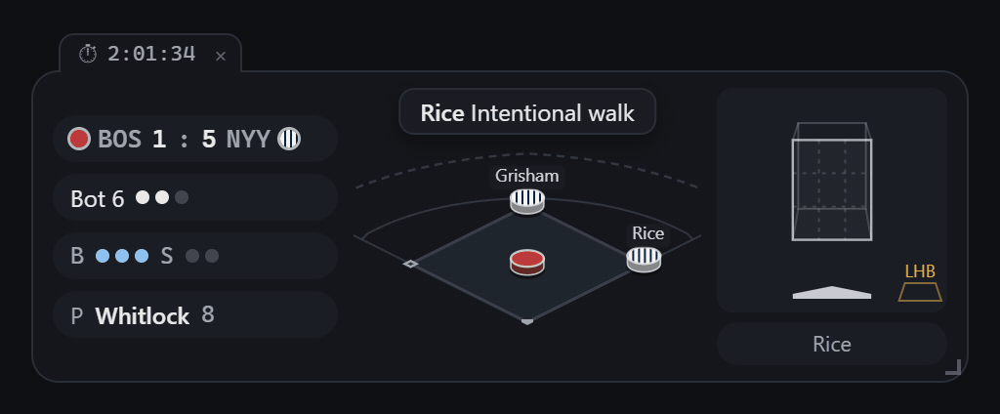
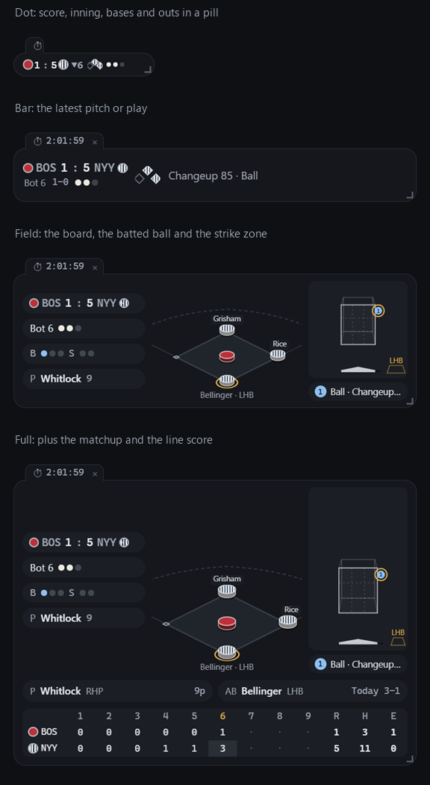

<!-- readme-standard: 2.1.2; type: A; has: autoupdate,binaries; brands: MLB -->

# Basesmall

**Baseball, but small.**

Unofficial MLB game window for Windows: a tiny desktop companion for the game you can't watch.

**[Download for Windows (.exe)](https://github.com/Zaious/basesmall/releases/latest)** · [macOS and Linux (experimental)](#download) · [Getting started](#getting-started)



*A replay of the 2026 AL Wild Card Series, Game 2: Boston walks Rice to face Bellinger, who hits a three-run home run. [MP4 version](docs/media/demo.mp4)*

For when you can't have the game on at work. Basesmall sits in a corner of your screen and keeps your team's game going as a few abstract pieces: who is on base, the count, the outs, the score, where each pitch crossed the plate, and which way the ball went. One glance tells you what just happened, without video, without sound unless you want it, and without looking like you are watching sports.

> **Status: 0.1.2 · Windows; macOS and Linux builds are experimental · macOS tried on one Intel Mac only, Linux not yet on a real machine.**

> [!WARNING]
> The Windows build is not code-signed: Windows warns before the first run, and a PC that blocks unsigned programs will not run it. See [Download](#download).

Free · Apache-2.0 · no account, no analytics (see [Privacy](#privacy))

## What it does

- **Your team's game, without looking for it.** Choose a team once. If it is playing, Basesmall follows the game; if not, it counts down to the next one and names the probable starters. When the season is over it asks once what you want instead: the most tense game each day, a team to adopt for the postseason, your own pick, or rest until opening day.
- **As much as you want to see, from a pill to a panel.** The smallest size is the score, the inning, three diamonds for the bases and the outs. Larger sizes add the board with team-coloured pieces and runners' names, the flight of the ball, the strike zone with every pitch numbered, the matchup and the line score. Drag the corner or press **⤢**. The strike zone, bases, matchup, line score and lineup can also each have a window of their own.
- **Quiet enough for the office.** Solid, translucent or transparent background, with text on small capsules so it stays readable on any wallpaper. Low-key mode turns it into a plain strip of numbers that does not look like sports, with no notices and no sound.
- **Tells you about the plays you care about.** A card in the corner or a ticker along an edge of the screen for the plays you choose; notices never take focus from what you are typing in. Short synthesised sounds for hits and home runs, and a quieter set for strikes, full counts, bunts and strikeouts, all off by default.
- **The rest of the league at a glance.** A drawer with every game today, the tensest first; series and game numbers in the postseason; a quiet tab when another game reaches a big moment. Rest the pointer on a piece for that player's line today so far and, in a live game, the season (or postseason) numbers.
- **Catch up, or watch again without spoilers.** Replays of games from the 2023 season onward, at a compact pace that keeps the pitch-to-pitch rhythm, or one half-inning at a time. Joined a game late? Catch up from the first inning with results only, then carry on live. Scores stay hidden while you pick a game, and in a replay the players' lines, the lineups and the pitchers only count up to the moment on screen.
- **Your look, your language.** Flat and 2.5D styles are built in; every style is a file, and new ones are welcome ([styles/](styles/)). English and Traditional Chinese.



*The four sizes, from the score alone to the full panel.*

New here? Start with [Getting started](#getting-started).

## What it does not do

- It shows no video, plays no broadcast and has no commentary.
- It is not instant. On 2026-10-04, a count or an out showed up in the window a median of 13 seconds after it appeared in MLB's own live feed; it was not compared with a TV broadcast. Method and numbers: [docs/ARCHITECTURE.md](docs/ARCHITECTURE.md) (in Traditional Chinese).
- It covers MLB only. When it was built, no other league had public play-by-play data it could use; [CONTRIBUTING.md](CONTRIBUTING.md#adding-another-league) explains how another league could be added.

## Download

From the [latest release](https://github.com/Zaious/basesmall/releases/latest):

| | File | Notes |
| --- | --- | --- |
| Windows, installer | `Basesmall_x.y.z_x64-setup.exe` | Installs for your user only: no administrator rights. |
| Windows, portable | `Basesmall_x.y.z_x64_portable.zip` | Nothing to install. Unzip anywhere and run `Basesmall.exe`. For PCs where installing is locked. |
| macOS (experimental) | `Basesmall_x.y.z_universal.dmg` | Signed and notarised by Apple. Drag it into Applications. One download for Intel and Apple Silicon. Tried on one Intel Mac only. |
| Linux (experimental) | `.AppImage` or `.deb` | Make the AppImage executable, then run it. Not yet tried on a real machine. |

> [!WARNING]
> **"Windows protected your PC"?** Basesmall is not code-signed, so Windows shows a warning. Click **More info**, then **Run anyway**. For the portable zip you can also right-click `Basesmall.exe`, open **Properties** and tick **Unblock**.

If your workplace blocks unsigned programs entirely, neither Windows version will run there.

**Check the file.** The release page shows a SHA-256 next to each file. Compare it with what this command prints for the file you downloaded:

```powershell
Get-FileHash .\Basesmall_x.y.z_x64-setup.exe -Algorithm SHA256
```

This guards against a damaged download, not against a tampered release page.

### Getting started

You need Windows 10 or 11 with the Microsoft Edge WebView2 Runtime, which Windows 11 includes and most Windows 10 PCs already have. There is no account or key to set up.

1. Run the installer, or unzip the portable zip and run `Basesmall.exe`.
2. Answer **Which team is yours?**, or choose **No team**. You can change it later in settings.
3. To change the window's size, drag its corner or press **⤢**.

If your team is playing, Basesmall now shows its game; if not, it counts down to the next one and names the probable starters.

### Updates

Installed copies ask GitHub for a newer version once each time the app starts; you can switch this off in Settings, and check by hand there too. When there is one, the settings button shows a dot and Settings offers **Update**. Nothing is downloaded until you press it; then Basesmall downloads the update, installs it and restarts. The Windows installer, the macOS app and the Linux AppImage update this way; the portable zip and the `.deb` only show a link to the download page. Updates are checked against a signature before they install. This is separate from Windows code signing.

## Usage

In a game, hover over the window for the controls: **⤢** size, **◇** style, **▤** scoreboard, **◱** low-key mode, **⏩** catch up, **⚙** settings, **‹** back to the game list. The tray icon has the same and more: show or hide, click-through, always on top, background.

| Windows, Linux | macOS | Does |
| --- | --- | --- |
| Ctrl+Alt+Shift+B | ⌥⇧⌘B | Hide or show every Basesmall window |
| Ctrl+Alt+Shift+L | ⌥⇧⌘L | Low-key mode on or off |

Both can be changed or switched off in settings. Settings live in `settings.json` in the app's config folder (on Windows `%APPDATA%\io.github.zaious.basesmall\`). Custom styles go in its `styles` folder.

## Documentation

- [Changelog](CHANGELOG.md)
- [Style file format](styles/README.md)
- [Portable copy notes](docs/PORTABLE.txt)
- In Traditional Chinese: [architecture](docs/ARCHITECTURE.md), [data source and terms](docs/DATA_SOURCE.md), [data probe report](docs/PROBE_REPORT.md)

## Privacy

Basesmall runs on your computer. There is no account, and the app has no analytics. It connects only to:

- `statsapi.mlb.com`, for game data, schedules and player numbers, while the app is open.
- GitHub, once each time the app starts (you can switch this off in Settings) and when you check in Settings, to see whether a newer version exists. An update is downloaded from GitHub only when you press **Update**.

The **Website** and **Source code** buttons in Settings open your browser; the app itself does not load those pages.

To delete what Basesmall stores on Windows, quit it and delete `%APPDATA%\io.github.zaious.basesmall` (settings, window positions and your styles) and `%LOCALAPPDATA%\io.github.zaious.basesmall` (the WebView2 data). To keep your settings, copy `settings.json` from the first folder before you delete it.

## Under the hood

Tauri 2 with a TypeScript front end. MLB's data is first turned into a normalised game model, and the board and everything else draw only from that model ([architecture](docs/ARCHITECTURE.md), in Traditional Chinese).

How I check that it is right: the data adapter is tested against MLB's own line score and box score on recorded games ([tests/timeline.test.ts](tests/timeline.test.ts)), and in October 2026 a 12-inning game was replayed with every step's board checked against the official state, with no mismatches. [CI](.github/workflows/ci.yml) runs the type check and the tests on every push and builds the app on a clean Windows runner.

## Build from source

You need Node.js 24, Rust 1.80 or later and, on Windows, the MSVC build tools.

Install the dependencies from the lockfile and build the app. It lands in `src-tauri/target/release/basesmall.exe` (`basesmall` on macOS and Linux):

```bash
npm ci
npm run tauri build -- --no-bundle
```

That is all a fresh machine needs; [CI](.github/workflows/ci.yml) does the same on a clean Windows runner for every push, and runs these checks as well:

```bash
npm run typecheck
npm test
```

Start the floating window with live reload, for development:

```bash
npm run tauri dev
```

Record a few finished games into `fixtures/mlb/` (git-ignored), so that the full test suite runs:

```bash
node scripts/probe/07-fixtures.mjs
```

Installers as released, with the third-party licences inside: run `node scripts/third-party-licenses.mjs`, then `npm run tauri build -- --config src-tauri/tauri.release.conf.json`.

To open a game directly, run `basesmall --game=<gamePk>` to follow it live, or add `--mode=replay` to replay a finished one.

## Contributing and getting help

Stuck, or found a mistake? Open an [issue](https://github.com/Zaious/basesmall/issues); you need a free GitHub account. Issues and pull requests in English or Chinese are both fine. To report a security problem privately, see [SECURITY.md](SECURITY.md).

Team colours that look wrong, styles, bug reports and code are all welcome: see [CONTRIBUTING.md](CONTRIBUTING.md). It also explains how to add another league.

## Data, trademarks and disclaimers

- Unofficial fan project. Not sponsored or endorsed by Major League Baseball or any club.
- Basesmall reads the MLB Stats API: its game data comes from there, fetched directly by your own computer. That data belongs to MLB Advanced Media, L.P. (MLBAM) and is subject to MLBAM's [copyright notice](http://gdx.mlb.com/components/copyright.txt), which says: "Only individual, non-commercial, non-bulk use of the Materials is permitted and any other use of the Materials is prohibited without prior written authorization from MLBAM." Basesmall does not host, relay or redistribute MLB data. This repository holds no MLB data apart from what the app shows in the pictures and the video in `docs/media`.
- MLB, club names, abbreviations and logos, and player names belong to their respective owners. Basesmall uses no logos, wordmarks, uniform numbers or league marks: teams appear by name, abbreviation, colour and, for a few teams, a simple pattern such as pinstripes. This repository holds those names, abbreviations and colour values in `styles/team-colors/mlb.json`; the colour values come from [colorr](https://github.com/lobsterbush/colorr) (MIT), see [its notice](styles/team-colors/NOTICE.md).

## Sponsor

Basesmall is free and stays free: no ads, no paid features, and no donation links inside the app. If Basesmall is useful to you, you can [buy me a coffee](https://buymeacoffee.com/zaious). It unlocks nothing, and every feature is the same for everyone.

## Licence

[Apache License 2.0](LICENSE) (`Apache-2.0`), with [NOTICE](NOTICE). Copyright 2026 ChronicleCore Studio. This licence covers the code in this repository, including the app's icons. MLB data, including what the app shows in the pictures and the video in `docs/media`, is not part of it, and neither is the name Basesmall. Releases include `THIRD_PARTY_LICENSES.txt` with the licences of everything compiled into the app. The code was first published under the MIT licence and moved to Apache-2.0 on 2026-10-04 (commit `c8d3c7c`), before the first release; the commits before that one remain under the MIT licence.

A work based on Basesmall must keep the attribution notices in NOTICE (section 4(d)). Section 6 of the licence does not grant permission to use the name "Basesmall", except for describing where the work comes from and reproducing the NOTICE.

---

Made by [Zaious](https://zaious.dev/) at ChronicleCore Studio 編年史記工作室. © 2026 ChronicleCore Studio.
